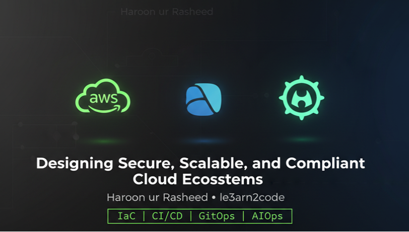

# Haroon Ur Rasheed

**Senior IT Administrator & Infrastructure Leader — Cloud Security · DevOps · Cybersecurity**

15+ years keeping enterprise IT running across the GCC — infrastructure, cloud, and security for a group of companies in Al Khobar, Saudi Arabia. I lead a five-person IT team and specialise in secure, compliant, well-documented systems.

---

## About

- **Location:** Al Khobar, Saudi Arabia · Remote
- **Current role:** Senior IT Administrator & Infrastructure Leader, Al-Fares Group of Companies (2010–present)
- **Education:** BSc Computer Science, University of Peshawar · EduQual UK Level 6 Diploma in AI Operations (Distinction)
- **Credentials:** AWS Certified Cloud Practitioner · CCNA · Cisco CyberOps Associate · MCITP / MCSA · Saudi Council of Engineers member
- **Compliance work:** ISO/IEC 27001, Saudi NCA controls, Aramco CCC readiness, PDPL

## What I do

- **Infrastructure & systems** — RHEL/Windows Server, VMware, enterprise networking (Cisco, Sophos)
- **Cloud & DevOps** — AWS, Docker, Kubernetes/OpenShift, Terraform, Jenkins CI/CD
- **Cybersecurity** — security operations, access control and authorization, log analysis, GRC and audit readiness
- **AI & automation** — Python/Bash automation, AI-assisted operations and applied AI projects

## Featured projects

| Project | What it shows |
| --- | --- |
| 🔐 [google-cybersecurity-portfolio](https://github.com/le3arn2code/google-cybersecurity-portfolio) | Google Cybersecurity Professional Certificate — hands-on Linux labs (permissions & authorization, grep log filtering, package management) with verified write-ups · 25/25 lab checks |
| ☁️ [aws-security-baseline](https://github.com/le3arn2code/aws-security-baseline) | AWS security baseline — guardrails and controls implemented as code, with threat model |
| 🧩 [openshift-operations](https://github.com/le3arn2code/openshift-operations) | OpenShift operations portfolio — RBAC, SCC, network policy, operators, pipelines, upgrades, troubleshooting runbooks |
| 🤖 [ai-ml-internship-projects](https://github.com/le3arn2code/ai-ml-internship-projects) | Applied AI/ML projects, including a LangChain + FAISS RAG chatbot |
| 🐳 docker-production *(consolidating)* | Docker in production — images, Compose, CI/CD integration (merging my earlier Docker lab repos) |

## Toolbox

**Cloud & containers:** AWS · Azure · Docker · Kubernetes · OpenShift · Helm · Argo CD
**DevOps & IaC:** Terraform · Ansible · Jenkins · Git
**Systems & security:** Linux (RHEL) · Bash · Python · Cisco · Sophos · Oracle Fusion ERP

## Currently

- Completing the **Google Cybersecurity Professional Certificate** (labs logged in the portfolio repo above)
- Building toward freelance **Forward Deployed Engineering** — RAG systems, AI agents, secure cloud deployment
- Studying toward CISA / CEH

## GitHub stats

## Connect

- **Portfolio site:** [le3arn2code.github.io](https://le3arn2code.github.io)
- **LinkedIn:** [linkedin.com](https://www.linkedin.com/)

*"Built 100s of hands-on labs across DevOps, SysOps, security & AI — code, coffee & consistency."*

